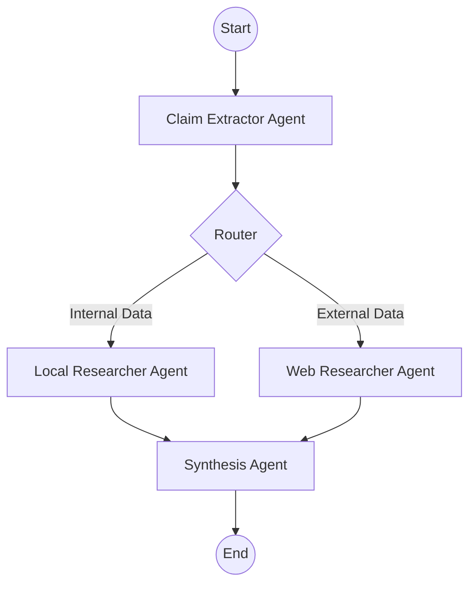

# 03: Multi-Agent Pipeline (LangGraph)

## File: `src/pipeline.py`

The system uses **LangGraph** to orchestrate a sophisticated multi-agent workflow. This allows the fact-checker to handle claims dynamically, routing them to the most appropriate research tools.

### Workflow Structure

The pipeline is modeled as a `StateGraph`, where each node is an intelligent agent or a research tool.

#### 1. State Management (`AgentState`)
The `AgentState` (defined in `src/state.py`) persists throughout the execution, storing:
- `raw_input`: The original social media post.
- `extracted_claim`: The normalized English claim.
- `routing_destination`: The next node in the research path.
- `agent_outputs`: Findings collected from the researchers.
- `final_verdict`: The consolidated analysis.

#### 2. The Graph Nodes
- **`claim_extractor`**: The entry point. It analyzes the input and identifies if the claim can be verified using local OSINT data or requires a broad web search.
- **`local_researcher`**: Specialized in searching the internal ChromaDB/BM25 database.
- **`web_researcher`**: Specialized in performing real-time internet searches via OSINT tools.
- **`synthesis`**: The final aggregator that weighs evidence and generates the verdict.

#### 3. Routing Logic
The `router` function inspects the `routing_destination` set by the extractor:
- If `local_researcher`, it prioritizes internal evidence.
- If `web_researcher`, it initiates a global internet search.

### Workflow Execution Flow

### Key Functions
- `router(state)`: Checks the destination flag in the state.
- `run_fact_checker(input_text)`: The main entry point that initializes the state and invokes the compiled graph.
